# Activité 1 – Bank Account Service

> Micro-service de gestion de comptes bancaires développé avec **Spring Boot**, exposant les mêmes données via une **API REST**, une API **Spring Data REST (HAL)**, une documentation **Swagger / OpenAPI** et une API **GraphQL**.

**Auteure :** Wahiba MOUSSAOUI
**Dépôt GitHub :** [wahiba155/Activit-1_bank-account-service](https://github.com/wahiba155/Activit-1_bank-account-service)

---

## Table des matières

1. [Objectif du projet](#1-objectif-du-projet)
2. [Technologies utilisées](#2-technologies-utilisées)
3. [Architecture et modèle de données](#3-architecture-et-modèle-de-données)
4. [Base de données H2](#4-base-de-données-h2)
5. [API REST](#5-api-rest)
6. [Spring Data REST (HAL et pagination)](#6-spring-data-rest-hal-et-pagination)
7. [Documentation Swagger / OpenAPI](#7-documentation-swagger--openapi)
8. [API GraphQL](#8-api-graphql)
9. [Conclusion](#12-conclusion)

---

## 1. Objectif du projet

Ce projet a pour but de mettre en place un service de gestion de comptes bancaires et de manipuler plusieurs styles d'API sur un même modèle métier :

- opérations **CRUD** sur les comptes bancaires via un contrôleur REST ;
- exposition automatique du repository via **Spring Data REST** (format HAL, pagination) ;
- documentation interactive via **Swagger UI** ;
- interrogation et modification des données via **GraphQL** (GraphiQL), avec la relation **Client → Comptes**.

Les tests ont été réalisés avec le navigateur, **Postman**, **Swagger UI**, **GraphiQL** et la console **H2**.

## 2. Technologies utilisées

| Domaine | Technologie |
|---|---|
| Langage / Framework | Java, Spring Boot |
| Build | Maven (`mvnw`) |
| Persistance | Spring Data JPA |
| Base de données | H2 en mémoire (`jdbc:h2:mem:account-db`, H2 2.4.240) |
| API REST | Spring Web (`account-rest-controller`) |
| API hypermédia | Spring Data REST (HAL) |
| Documentation | springdoc-openapi (Swagger UI, OAS 3.1) |
| API GraphQL | Spring for GraphQL + GraphiQL |
| Tests manuels | Postman, navigateur, Swagger UI, GraphiQL |

> Le service écoute sur le port **8081**.

## 3. Architecture et modèle de données

### Entité `BankAccount`

| Champ | Type | Description |
|---|---|---|
| `id` | `String` (UUID) | Identifiant unique |
| `createdAt` | Date (`Instant`) | Date de création |
| `balance` | `Double` | Solde |
| `currency` | `String` | Devise (`MAD`, `USD`…) |
| `type` | Enum | `SAVING_ACCOUNT` ou `CURRENT_ACCOUNT` |

### Entité `Customer` (côté GraphQL)

| Champ | Type | Description |
|---|---|---|
| `id` | `ID` | Identifiant du client |
| `name` | `String` | Nom du client |
| `bankAccounts` | `[BankAccount]` | Comptes du client |

Relation : un **client** possède plusieurs **comptes** ; chaque compte référence son **client**.

## 4. Base de données H2

Les données sont stockées dans une base H2 **en mémoire**, alimentée au démarrage par des comptes générés aléatoirement (soldes aléatoires, types `SAVING_ACCOUNT` / `CURRENT_ACCOUNT`, devise `MAD`). La console H2 permet de vérifier le contenu de la table `BANK_ACCOUNT`.

```sql
SELECT * FROM BANK_ACCOUNT;
```

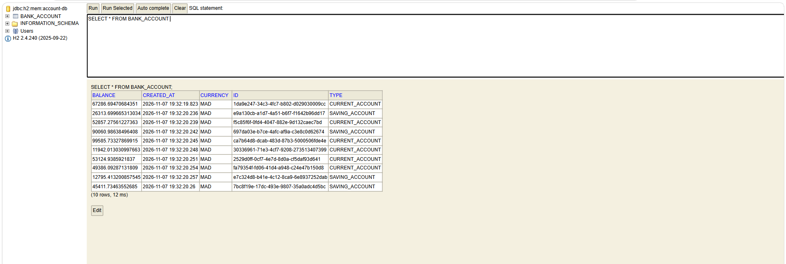

<p align="center"><em>Figure 1 : Console H2 – table BANK_ACCOUNT</em></p>

*La requête retourne 10 lignes avec les colonnes `BALANCE`, `CREATED_AT`, `CURRENCY`, `ID` et `TYPE`.*

## 5. API REST

### 5.1 Consulter les comptes – `GET /bankAccounts`

Le contrôleur REST retourne la liste complète des comptes au format JSON.

**Dans le navigateur :**

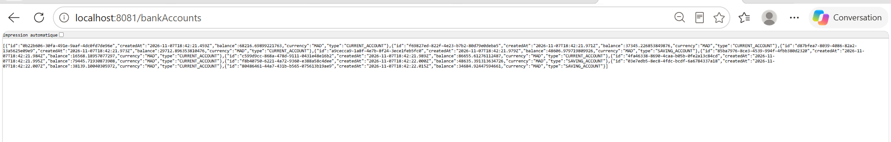

<p align="center"><em>Figure 2 : GET /bankAccounts dans le navigateur</em></p>

**Dans Postman** (`200 OK`) :

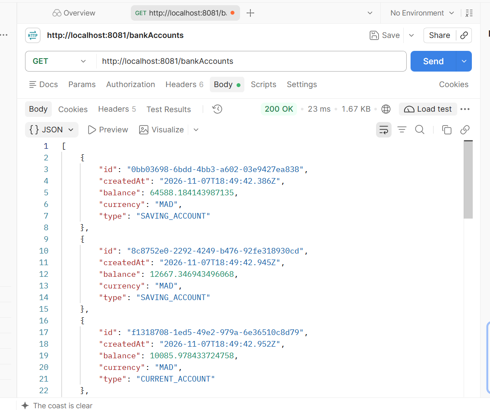

<p align="center"><em>Figure 3 : GET /bankAccounts avec Postman</em></p>

### 5.2 Créer un compte – `POST /bankAccounts`

Requête envoyée avec Postman :

```json
{
  "balance": "70000",
  "currency": "MAD",
  "type": "SAVING_ACCOUNT"
}
```

Le serveur génère l'`id` (UUID) et retourne le compte créé avec un statut `200 OK` :

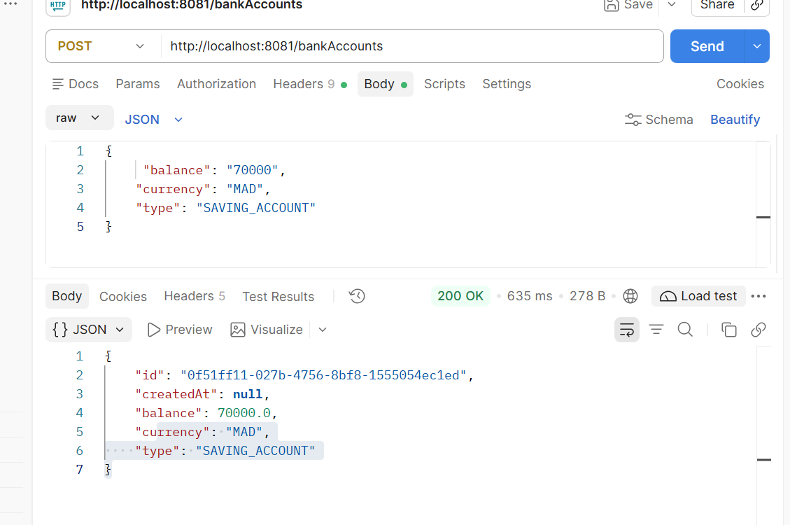

<p align="center"><em>Figure 4 : POST /bankAccounts avec Postman</em></p>

Le nouveau compte apparaît ensuite dans la liste (dernier élément, solde `70000.0`) :

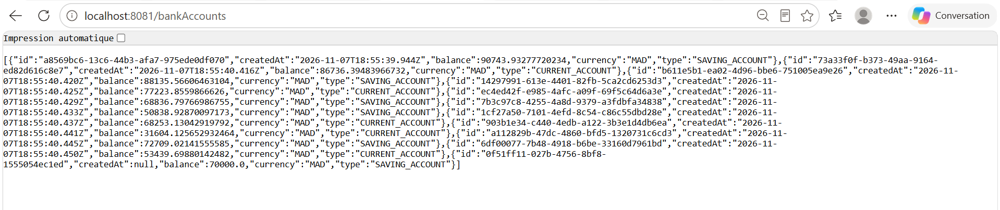

<p align="center"><em>Figure 5 : Liste des comptes après la création</em></p>

### 5.3 Modifier un compte – `PUT /bankAccounts/{id}`

Mise à jour de la devise d'un compte existant :

```json
{
  "currency": "USD"
}
```

La réponse montre que seule la devise a changé (`MAD` → `USD`), les autres champs étant conservés :

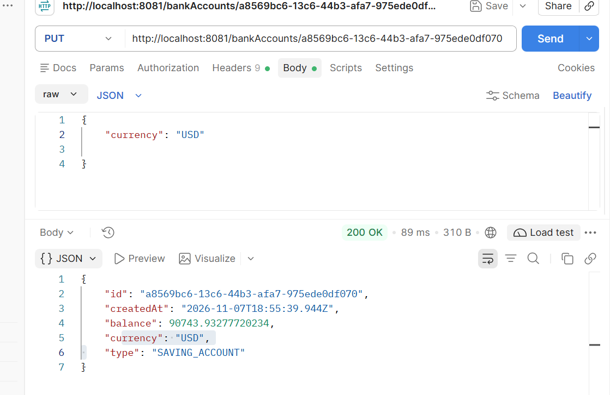

<p align="center"><em>Figure 6 : PUT /bankAccounts/{id} avec Postman</em></p>

## 6. Spring Data REST (HAL et pagination)

En plus du contrôleur, le repository est exposé via **Spring Data REST**. Les réponses suivent le format **HAL** avec des liens hypermédias (`_links`, `self`, `profile`, `first`, `next`, `last`).

### 6.1 Liste au format HAL

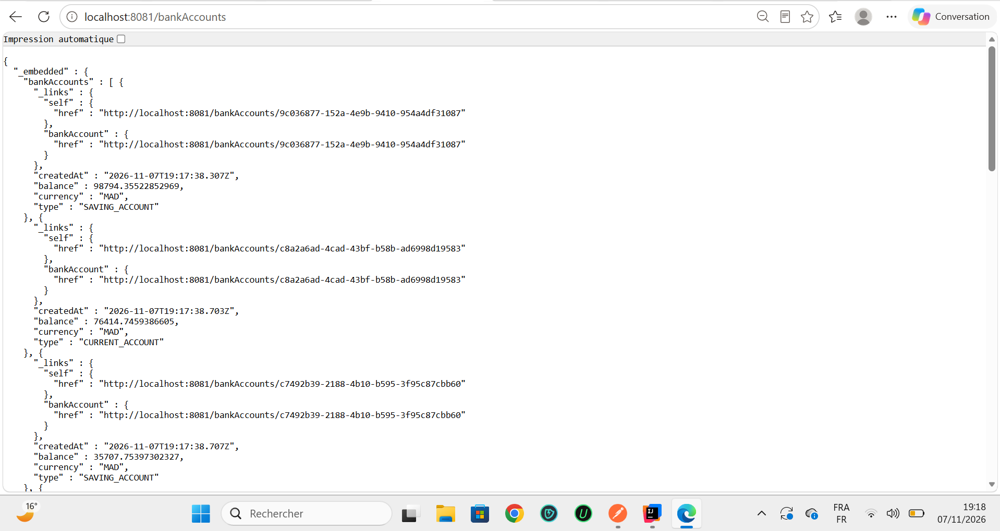

<p align="center"><em>Figure 7 : GET /bankAccounts en format HAL</em></p>

### 6.2 Pagination – `?page=0&size=2`

La pagination se fait avec les paramètres `page` et `size`. Ici : première page, 2 éléments par page, 10 éléments au total, soit 5 pages (liens `first`, `next` et `last`).

```
GET http://localhost:8081/bankAccounts?page=0&size=2
```

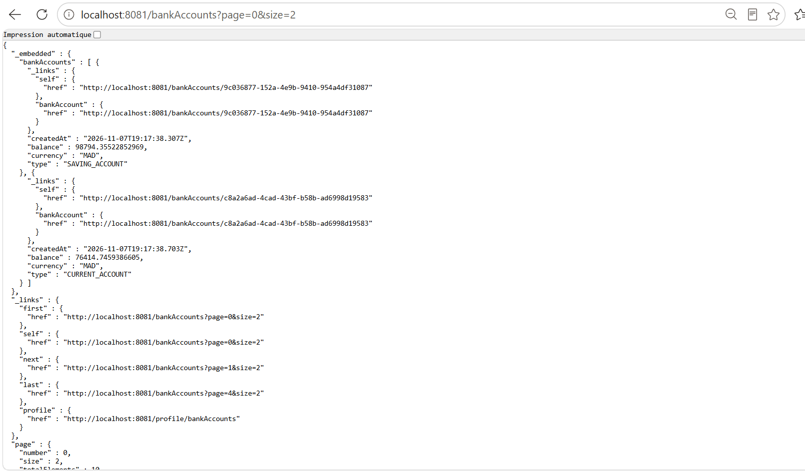

<p align="center"><em>Figure 8 : Pagination Spring Data REST</em></p>

## 7. Documentation Swagger / OpenAPI

La documentation de l'API est générée automatiquement (OpenAPI **3.1**, spécification disponible sur `/v3/api-docs`) et consultable via **Swagger UI**.

### 7.1 Vue d'ensemble des endpoints

Le contrôleur `account-rest-controller` expose cinq opérations :

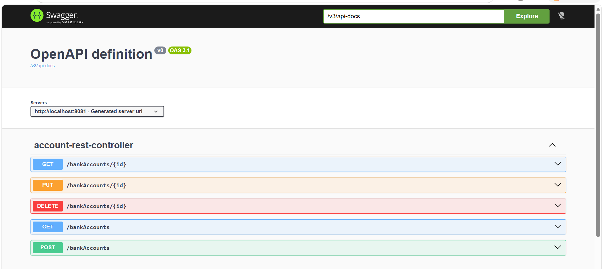

<p align="center"><em>Figure 9 : Swagger UI – liste des endpoints</em></p>

### 7.2 Test de `GET /bankAccounts`

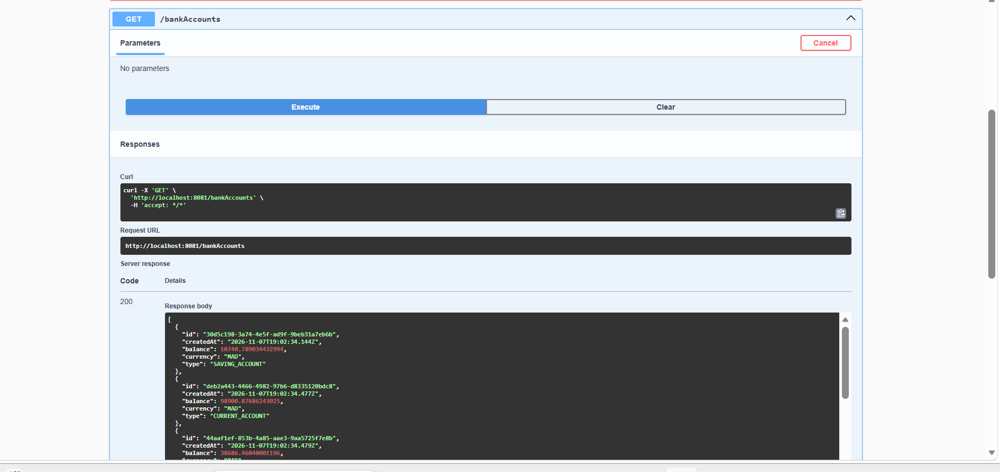

<p align="center"><em>Figure 10 : Swagger – GET /bankAccounts</em></p>

### 7.3 Test de `POST /bankAccounts`

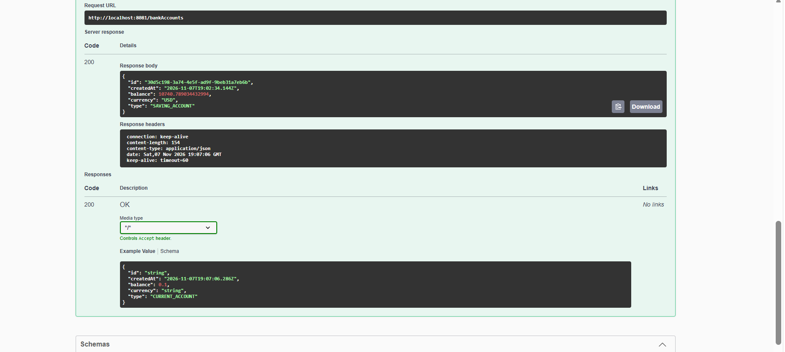

<p align="center"><em>Figure 11 : Swagger – POST /bankAccounts</em></p>

## 8. API GraphQL

L'API GraphQL est testée avec **GraphiQL**. Elle permet de ne récupérer que les champs nécessaires et de naviguer dans la relation client ↔ comptes.

### 8.1 Requêtes (Queries)

**Liste des identifiants des comptes – `accountsList`**

```graphql
query {
  accountsList {
    id
  }
}
```

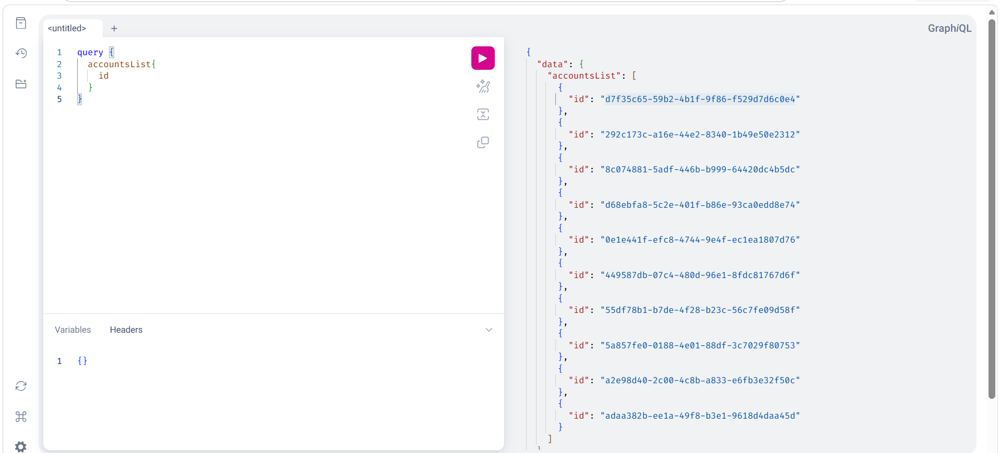

<p align="center"><em>Figure 12 : accountsList – identifiants</em></p>

**Compte par identifiant – `bankAccountById`**

```graphql
query {
  bankAccountById(id: "d7f35c65-59b2-4b1f-9f86-f529d7d6c0e4") {
    balance, currency
  }
}
```

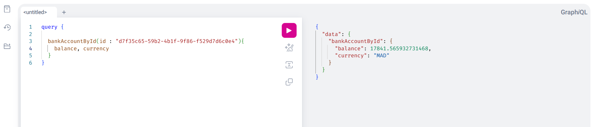

<p align="center"><em>Figure 13 : bankAccountById</em></p>

**Liste des clients – `customers`**

```graphql
query {
  customers {
    id, name
  }
}
```

Le résultat contient quatre clients : *wahiba*, *oumima*, *med* et *aymen*.

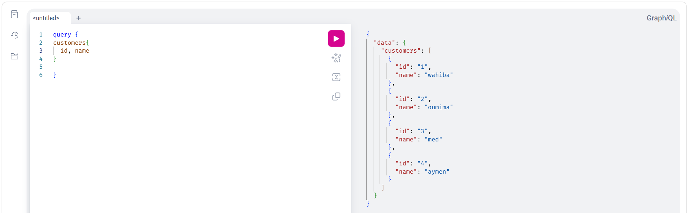

<p align="center"><em>Figure 14 : customers – id et name</em></p>

**Clients avec leurs comptes bancaires**

```graphql
query {
  customers {
    id, name, bankAccounts { balance, id }
  }
}
```

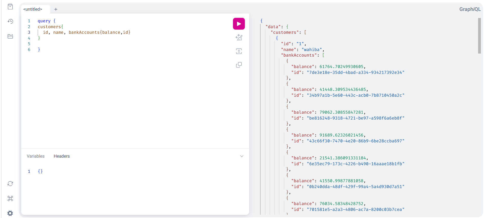

<p align="center"><em>Figure 15 : customers avec bankAccounts</em></p>

**Comptes avec leur client (relation inverse)**

```graphql
query {
  accountsList {
    id, balance, customer { name, bankAccounts { id } }
  }
}
```

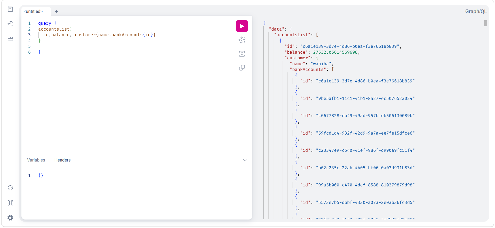

<p align="center"><em>Figure 16 : accountsList avec customer</em></p>

### 8.2 Mutations

**Ajouter un compte – `addAccount`**

```graphql
mutation {
  addAccount(bankAccount: {
    type: "SAVING_ACCOUNT",
    balance: 145289,
    currency: "USD"
  }) {
    id, type, balance
  }
}
```

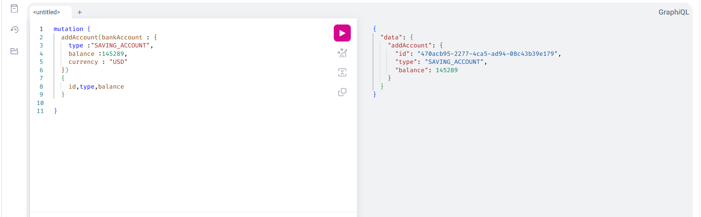

<p align="center"><em>Figure 17 : Mutation addAccount</em></p>

**Supprimer un compte – `deleteAccount`**

On supprime le compte créé précédemment (`470acb95-…`) ; la mutation retourne `true`.

```graphql
mutation {
  deleteAccount(id: "470acb95-2277-4ca5-ad94-08c43b39e179")
}
```

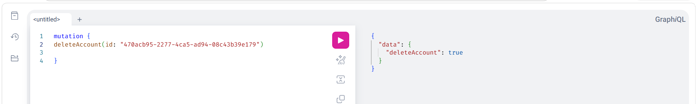

<p align="center"><em>Figure 18 : Mutation deleteAccount</em></p>


## 9. Conclusion

Ce projet montre comment un même modèle de données (`BankAccount`, `Customer`) peut être exposé de plusieurs façons avec l'écosystème Spring : un contrôleur REST classique, Spring Data REST avec HAL et pagination, Swagger pour la documentation, et GraphQL pour des requêtes flexibles. Les tests réalisés avec Postman, Swagger, GraphiQL et la console H2 confirment le bon fonctionnement des opérations de lecture, de création, de modification et de suppression.
